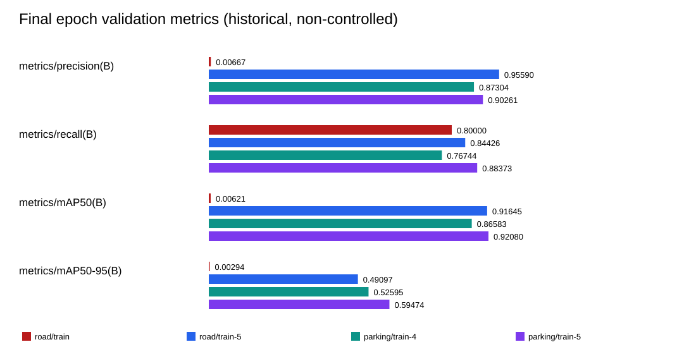
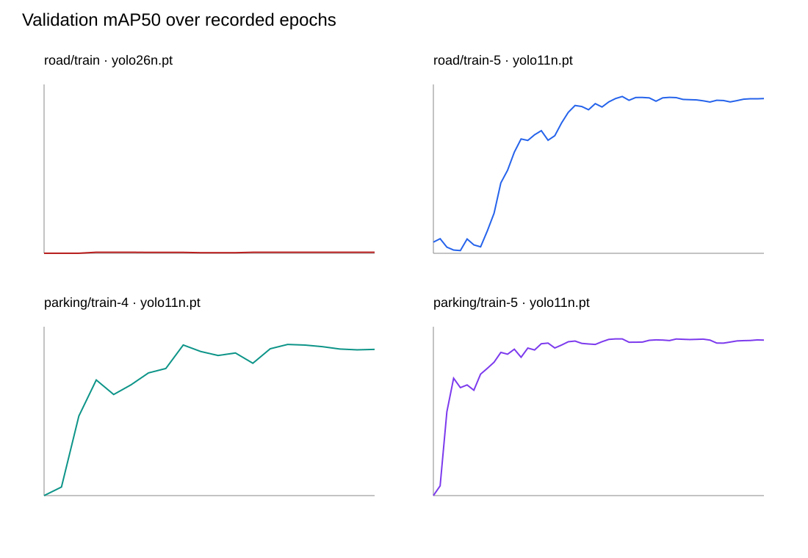

# YOLO Based Vehicle Detection · V1.0 Research Archive

An August 2026 CPU vehicle detection study, organized in November 2026. The cars are real; the claim of a controlled benchmark would be fiction. This archive covers road scenes (Project2) and parking lot experiments (Project3). The published [v0.1 prototype](https://github.com/chenyuru1102-ux/vehicle-detection/releases/tag/v0.1) and its history remain the starting point. V2.0 is a plan, not a trained model.

[繁體中文](README_zh-TW.md) · [Technical tutorial](docs/TECHNICAL_TUTORIAL_zh-TW.md) · [Limitations](docs/LIMITATIONS.md) · [V2.0 roadmap](docs/V2.0_ROADMAP.md)

## What was done

- **Road:** fixed interval video frame extraction, manual annotation, label inspection, random train/validation split, YOLO training, video inference, and custom overlays.
- **Parking:** grayscale mean difference screening once per second with threshold 15, YOLO prelabels, an OpenCV annotation tool with mouse add/delete and IoU > 0.5 duplicate filtering, YOLO label export, and exploratory four tile detection.
- **Not done:** parking space occupancy detection. `mark_parking_spaces.py` is empty. Tile outputs were not merged back into a full image.

## Historical final epoch validation

| Experiment | Model | Epochs | Batch | Size | Precision | Recall | mAP50 | mAP50–95 |
|---|---|---:|---:|---:|---:|---:|---:|---:|
| Road train | YOLO26n | 20 | 16 | 640 | 0.00667 | 0.80000 | 0.00621 | 0.00294 |
| Road train-5 | YOLO11n | 50 | 8 | 640 | 0.95590 | 0.84426 | 0.91645 | 0.49097 |
| Parking train-4 | YOLO11n | 20 | 4 | 416 | 0.87304 | 0.76744 | 0.86583 | 0.52595 |
| Parking train-5 | YOLO11n | 50 | 4 | 416 | 0.90261 | 0.88373 | 0.92080 | 0.59474 |

Values come from the last row of each original `results.csv`; models and settings come from each run's `args.yaml`. These runs differ in model, data, image size, batch size, and/or epoch count. **They are historical observations, not a fair head to head comparison.** The first road run has very poor precision and mAP despite 0.8 recall; its cause is unproven. Ten training folders exist, but only four have CSV results. Fifty one prediction folders are artifacts, not fifty one validated experiments. The saved JPG counts are road 86 train + 24 validation and parking 117 + 32; historical training set sizes are unconfirmed.

## Historical road scenes

The prototype documented urban traffic by day, low-light driving at night, and vehicles viewed from above. Public display rights for the historical images remain unconfirmed. V1.0 records these scenes in text. The images remain accessible in earlier commits and the v0.1 release archive.

## Repository map

- `historical/road` and `historical/parking`: all 18 Python files copied unchanged, including early tests and the empty parking script. They are historical evidence, not polished runnable modules.
- `experiments`: ten public copies of `args.yaml`, four original `results.csv`, available PR/F1/confusion/loss plots, generated comparison charts, and run inventory.
- `portable`: separate configuration examples for future runs. They do not replace the historical scripts.
- `docs`: tutorial, limitations, publication review, and roadmap.

## Reuse

Use Python 3.12 and install `requirements.txt` in a fresh environment. Supply your own licensed videos/datasets and model weights. Historical scripts contain fixed paths and can write labels; review paths and back up labels before running them. The `portable` YAML files show relative dataset paths. No training or inference was performed for this archive.

## Evidence boundaries

The author's recollection of one image with roughly three vehicles and more than 400 detections remains **unverified**: no matching original image and count were established. The local private archive retains source media, datasets, weights, and all inference outputs for further investigation. Public files are listed in [publication review](docs/PUBLICATION_REVIEW.md).

For a portable dataset, place the corresponding portable YAML at the root of your own dataset and pass its absolute filename to the YOLO CLI.

Public copies of the original execution configurations, with private local paths removed. This applies to the ten run configurations and the parking dataset YAML. The private research archive retains the complete originals. The road dataset YAML already used a relative path.
