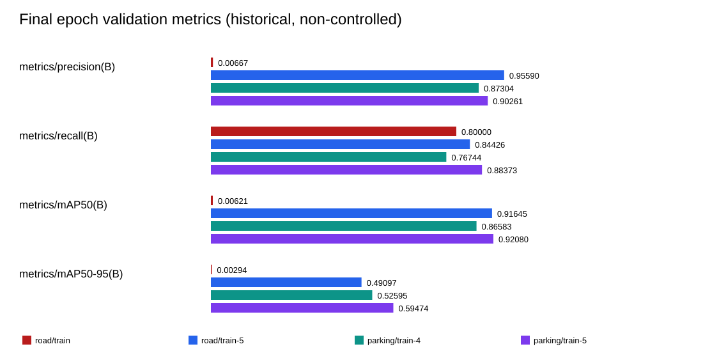
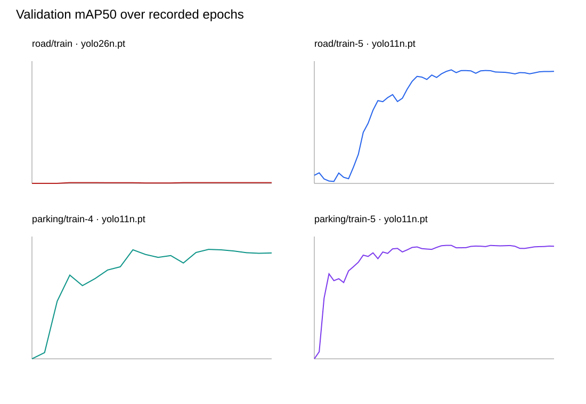

# YOLO 車輛辨識研究 · V1.0 封存

本版於 2026 年 11 月整理 8 月的 CPU 研究成果，涵蓋道路（Project2）與停車場（Project3）。[v0.1 原型版本](https://github.com/chenyuru1102-ux/vehicle-detection/releases/tag/v0.1)及原始 Git 歷史保留。V2.0 目前只有規劃，尚未重新訓練。

[English README](README.md) · [完整技術教學](docs/TECHNICAL_TUTORIAL_zh-TW.md) · [研究限制](docs/LIMITATIONS.md) · [V2.0 規劃](docs/V2.0_ROADMAP.md)

## 工作內容

道路：固定時間擷取影片影格、人工標註、標註檢查、隨機切割資料集、CPU 訓練、影片推論與自訂視覺化。停車場：每秒檢查一次灰階平均差異（門檻 15）、YOLO 自動預標註、自製 OpenCV 標註介面（滑鼠增刪框、IoU > 0.5 重複過濾）、YOLO 格式儲存，以及影像四等分探索。

`mark_parking_spaces.py` 為空檔，停車格占用辨識未完成；四塊推論結果也未合併回全圖。

## 原始 CSV 最後 Epoch 驗證數據

| Experiment | Model | Epochs | Batch | Size | Precision | Recall | mAP50 | mAP50–95 |
|---|---|---:|---:|---:|---:|---:|---:|---:|
| Road train | YOLO26n | 20 | 16 | 640 | 0.00667 | 0.80000 | 0.00621 | 0.00294 |
| Road train-5 | YOLO11n | 50 | 8 | 640 | 0.95590 | 0.84426 | 0.91645 | 0.49097 |
| Parking train-4 | YOLO11n | 20 | 4 | 416 | 0.87304 | 0.76744 | 0.86583 | 0.52595 |
| Parking train-5 | YOLO11n | 50 | 4 | 416 | 0.90261 | 0.88373 | 0.92080 | 0.59474 |

四筆數值擷取自各自 `results.csv` 最後一列；實際模型與訓練參數以各自 `args.yaml` 為準。模型、資料、影像尺寸與訓練參數不同，**不能視為公平對照**。第一個道路實驗精確率及 mAP 極低，原因未證實。10 個訓練目錄只有 4 份 CSV；51 個推論目錄也不等於 51 次完成的實驗。現存 JPG：道路 train 86／val 24，停車場 train 117／val 32，不能回推歷史訓練當時規模。

## 道路場景紀錄

原型曾記錄白天市區交通、夜間低光源行車及俯視車輛三種場景。由於歷史展示圖片的公開授權尚未確認，V1.0 僅保留文字紀錄。舊 commit 與 v0.1 Release 的原始碼封存仍可取得這些圖片，既有授權風險仍在。

## 使用與證據

`historical/` 保留 18 支原始程式，不表示可直接移植執行；`portable/` 是獨立的相對路徑設定範例。安裝 `requirements.txt` 後仍需自行提供有授權的資料與權重。執行原始程式前須檢查固定路徑和標註覆寫風險。這次封存未執行訓練或推論。

「約三台車被偵測成四百多台」目前僅為**本人回憶、尚未驗證**，尚未找到足以確認圖片及數字的原始證據。公開版不附未確認授權的影片、資料集、權重或新增推論圖片。詳見[公開審查](docs/PUBLICATION_REVIEW.md)。

請把 portable 裡的 YAML 放在自備資料集根目錄（與 images、labels 同層），傳入該 YAML 的絕對路徑。

Public copies of the original execution configurations, with private local paths removed. 十份訓練設定及停車場資料集設定已去除私人路徑。完整原檔保留於私有研究封存；道路資料集 YAML 原本即使用相對路徑。
